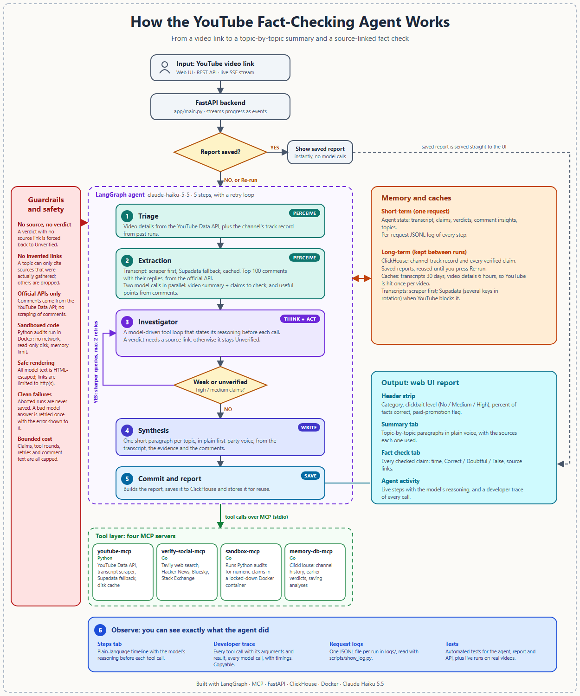
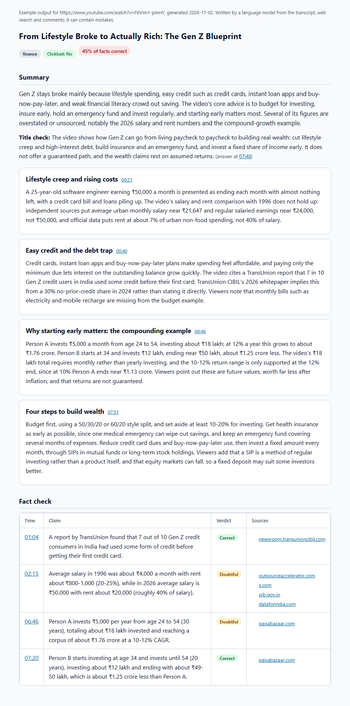

# Agentic YouTube Fact-Checker

A learning project: an autonomous agent that watches a YouTube video for you (through its transcript), checks the claims it makes against web evidence, reads the comments, and hands back a topic-by-topic summary plus a source-linked fact check.

I built it to learn how real agents are put together: a tool-calling loop, tools served over MCP, structured model output, guardrails against made-up answers, streaming progress to a UI, and the logging needed to understand what the agent actually did. It works end to end, but it is a personal project, not a product. See [Limitations](#limitations).



## What you get

Paste a video link and the report has a header strip and two tabs.

- **Header strip:** the video's category, a clickbait level (No / Medium / High), the percent of checked facts that are correct, and a flag when sponsors are detected.
- **Summary tab:** one short paragraph per topic, in plain voice, combining what the video says, what independent web sources confirm or contradict, and what viewers add in comments and replies. Each paragraph links the sources it used.
- **Fact check tab:** a plain table of every checked claim with its time, a verdict (Correct / Doubtful / False, or Unverified when no evidence was found) and source links.
- **Agent activity:** while it runs you watch the agent work, step by step, with its own stated reasoning before each tool call. A Developer trace tab shows every tool call with its arguments, every model call and the timings.

Finished reports are saved, so opening a video you already checked is instant and free. A **Re-run analysis** button runs it again.

### Example

A personal-finance video, with the Summary and Fact check tabs shown one after the other:

<p align="center"></p>

More examples as PDFs: [an MCP explainer (tech)](docs/examples/mcp-explainer.pdf), [a certification study guide (tutorial)](docs/examples/claude-exam.pdf) and [the personal-finance video above](docs/examples/gen-z-finance.pdf). They are real runs, written by the model, so they can contain mistakes. The percent shown counts only claims that could be checked.

## How it works

1. **Triage:** video details from the YouTube Data API, and the channel's track record from earlier runs (ClickHouse).
2. **Extraction:** the transcript, plus the top 100 comments with their replies. Two model calls run in parallel: one summarizes the video and picks claims worth checking, the other keeps only comments that add real information.
3. **Investigator:** a model-driven tool loop. It writes what it is looking for and why, then calls tools: web search (Tavily), community sites (Hacker News, Bluesky, Stack Exchange), a Python sandbox for numeric claims, and a lookup of earlier verdicts. A verdict needs a source link, otherwise it stays Unverified.
4. **Critic:** if important claims came back weak or unverified, it writes sharper search queries and sends the agent back to step 3, at most twice.
5. **Synthesis:** writes the topic paragraphs from the transcript, the evidence and the comments.
6. **Commit and report:** builds the report, saves the analysis to ClickHouse, stores the report for reuse.

The agent is a [LangGraph](https://langchain-ai.github.io/langgraph/) graph. Its tools live in four separate [MCP](https://modelcontextprotocol.io/) servers that it talks to over stdio:

| Server | Language | Does |
| :--- | :--- | :--- |
| `youtube-mcp` | Python | YouTube Data API (details, comments), transcripts, disk cache, Supadata fallback |
| `verify-social-mcp` | Go | Tavily web search, Hacker News, Bluesky, Stack Exchange |
| `sandbox-mcp` | Go | Runs Python in a Docker container: no network, read-only disk, memory limit |
| `memory-db-mcp` | Go | ClickHouse: channel history, earlier verdicts, saving analyses |

The web app is FastAPI with a plain HTML/JS page; progress reaches the browser as server-sent events.

## What it protects against

- **Made-up verdicts:** a verdict with no source link is forced back to Unverified. A topic can only cite sources that were actually gathered.
- **Unsafe output:** all model text is HTML-escaped, and links are limited to http(s).
- **Runaway cost:** the number of claims, tool rounds, retries and comment text are all capped.
- **Bad model answers:** a structured answer that fails validation is retried once with the error shown to the model; a missing optional step degrades the report instead of failing the run.
- **Code execution:** numeric claims are checked by Python running in a locked-down container.

## Getting started

You need Python 3.12+ with [uv](https://docs.astral.sh/uv/), Go, and Docker Desktop (running).

**1. API keys.** Copy `.env.example` to `.env` and fill it in.

| Key | Needed for |
| :--- | :--- |
| `ANTHROPIC_API_KEY` | the model (default `claude-haiku-5-5`, set with `ANTHROPIC_MODEL`) |
| `TAVILY_API_KEY` | web search for fact checking |
| `YOUTUBE_API_KEY` | video details and comments (YouTube Data API v3) |
| `SUPADATA_API_KEYS` | optional: comma-separated keys for the transcript fallback |

ClickHouse settings default to the values in `docker-compose.yml`. More detail on every key is in [SETUP_AND_KEYS.md](SETUP_AND_KEYS.md).

**2. Install and build.**

```powershell
uv sync
go build -o bin/memory-db-mcp.exe ./mcp-servers/memory-db
go build -o bin/sandbox-mcp.exe ./mcp-servers/sandbox
go build -o bin/verify-social-mcp.exe ./mcp-servers/verify-social
docker pull python:3.12-slim      # image the sandbox runs code in
docker compose up -d              # ClickHouse
```

On macOS or Linux, drop the `.exe` from the output names.

**3. Check the setup.**

```powershell
uv run python scripts/harness_check.py        # keys, Docker, ClickHouse, Tavily
uv run python scripts/mcp_protocol_check.py   # all four MCP servers over stdio
```

**4. Run it.**

```powershell
uv run uvicorn app.main:app --port 8000       # then open http://localhost:8000
uv run python scripts/run_e2e_test.py --url "https://www.youtube.com/watch?v=..."   # or from the CLI
```

The API: `GET /api/analyze/stream?video_url=...` (server-sent events; add `&refresh=true` to re-run) and `POST /api/analyze {"video_url": "...", "refresh": false}`.

## Transcripts and YouTube blocking

Transcripts come from `youtube-transcript-api`, which uses YouTube's internal endpoints and gets IP-blocked after heavy use. When that happens the agent falls back to [Supadata](https://supadata.ai/) (existing captions only, several keys rotated, results cached so a video costs at most one credit). The activity tab says when the fallback was used. Comments always come from the official API; there is no comment scraper.

## Debugging a run

Every analysis writes a JSONL log to `logs/`. Read it with:

```powershell
uv run python scripts/show_log.py            # latest request
uv run python scripts/show_log.py latest -v  # with tool arguments, results and model outputs
```

The same records stream into the Developer trace tab. This is how most of the bugs below were found.

## Tests

```powershell
uv run pytest
go test ./mcp-servers/memory-db/... ./mcp-servers/sandbox/... ./mcp-servers/verify-social/...
```

The Python tests run without network or API keys, using fake tools and a scripted fake model.

## Project layout

```
agent/            LangGraph nodes, prompts, schemas, report builder, run logging
app/              FastAPI app, HTML renderer, static page
mcp-servers/      youtube (Python); memory-db, sandbox, verify-social (Go)
docker/           ClickHouse schema
scripts/          setup checks, CLI runner, log viewer, diagram and example exporters
tests/            Python tests
docs/             architecture diagram, roadmap, example reports (docs/examples)
```

## What I learned

- **Make the agent show its work.** Per-request logs exposed bugs the agent had been quietly hiding: a database query that failed on every call, and a sandbox race condition. Without the logs the agent just looked a bit vague.
- **Never trust a model's structured output.** Models skip fields and rename them (a required `clickbait_rating` came back as `rating`, twice). Validate, retry once with the error, make secondary fields optional, and let non-essential steps fail soft.
- **Guardrails beat prompts.** "Do not invent sources" in a prompt is a wish. Forcing unsourced verdicts to Unverified in code is a guarantee.
- **Say what you did not find only when it is true.** Handing the model an empty "comments" section made it write sentences about the absence of comments. Leaving the section out fixed it.
- **Features that don't earn their keep should go.** I built a personalization feature, used it, and removed it.

## Limitations

- **Results vary between runs.** Re-running a video can pick different claims and give different verdicts.
- **Verdicts are not measured.** There is no set of videos with known errors to test against, so I can't say how often "Correct" is right. Treat the output as a research aid and open the sources.
- **The model writes the summaries.** The paragraphs and the overview can contain mistakes, including garbled statements about the evidence.
- **Only claims that can be checked on the web get checked.** Opinions, predictions and anything without public evidence end up Unverified or are skipped.
- **Local and single-user.** Reports, caches and the database run on your machine; there are no accounts or rate limits.
- **Reddit is off** until Reddit approves API access (see `SETUP_AND_KEYS.md`).
- **Windows-first.** I developed and tested it on Windows; the Go servers and paths should work elsewhere but are untested.

## Roadmap

Held for later, with the design notes in [docs/ROADMAP.md](docs/ROADMAP.md): a hosted API for other people, and a Chrome extension with a side panel that fetches transcripts in your own browser (which also avoids the IP-blocking problem).

## Docs

- [SETUP_AND_KEYS.md](SETUP_AND_KEYS.md): keys, running, logs, caches, report layout
- [docs/ROADMAP.md](docs/ROADMAP.md): what is done, what is held, known gaps
- `docs/architecture.svg`: editable diagram, regenerated by `scripts/make_architecture_diagram.py`
- `docs/examples/`: example reports as PDF, made with `scripts/export_example.py <videoId> <name> --pdf --png`
- [Agentic YouTube Analyzer & Fact-Checking Platform.md](Agentic%20YouTube%20Analyzer%20%26%20Fact-Checking%20Platform.md): the original project brief
